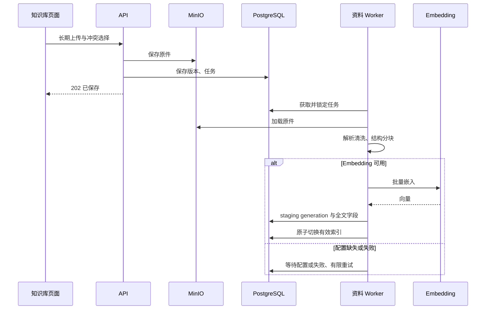
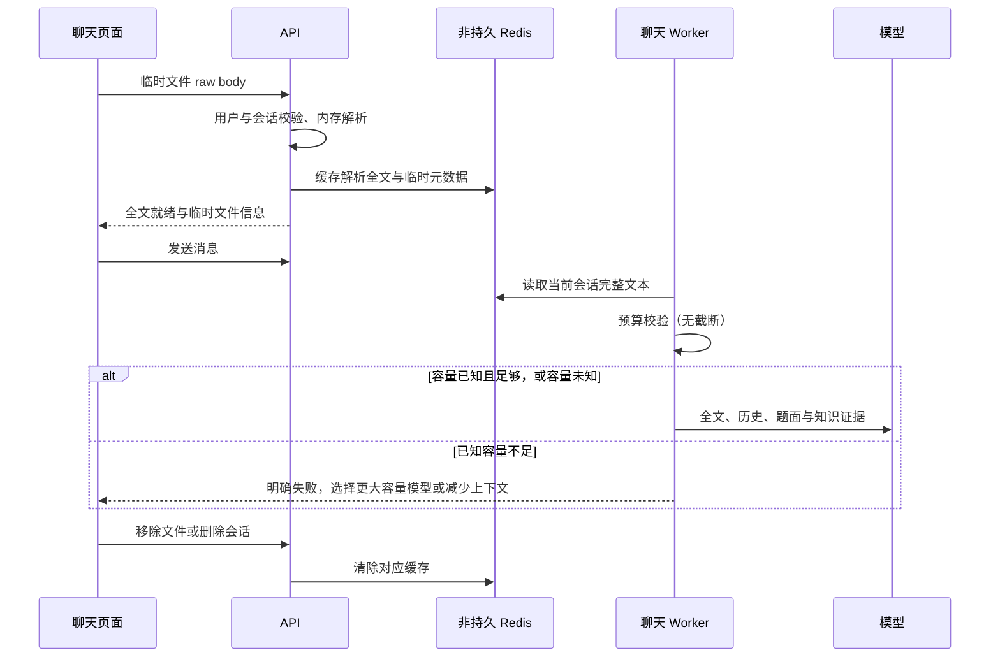
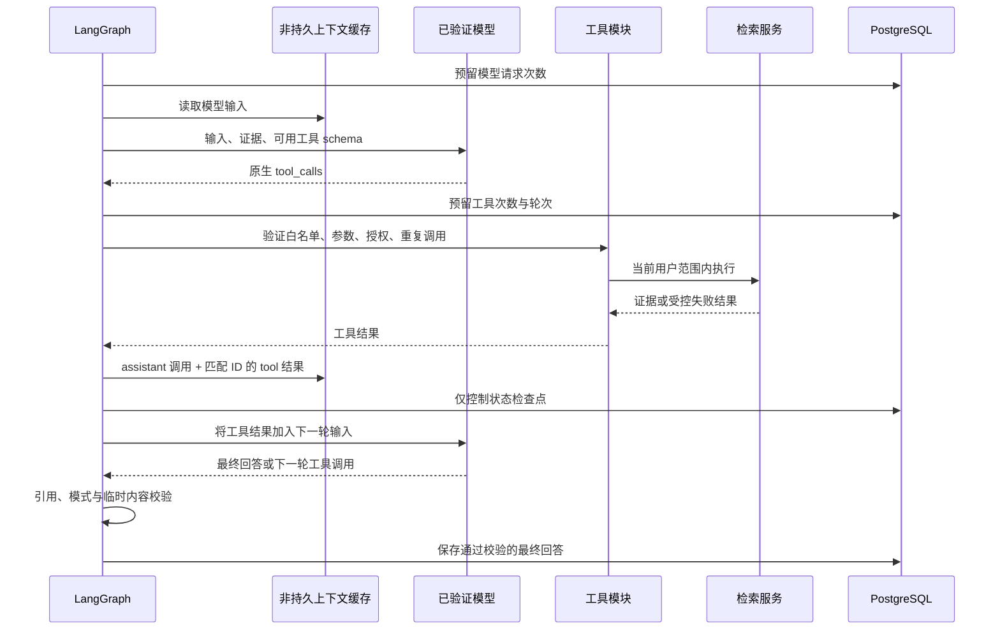
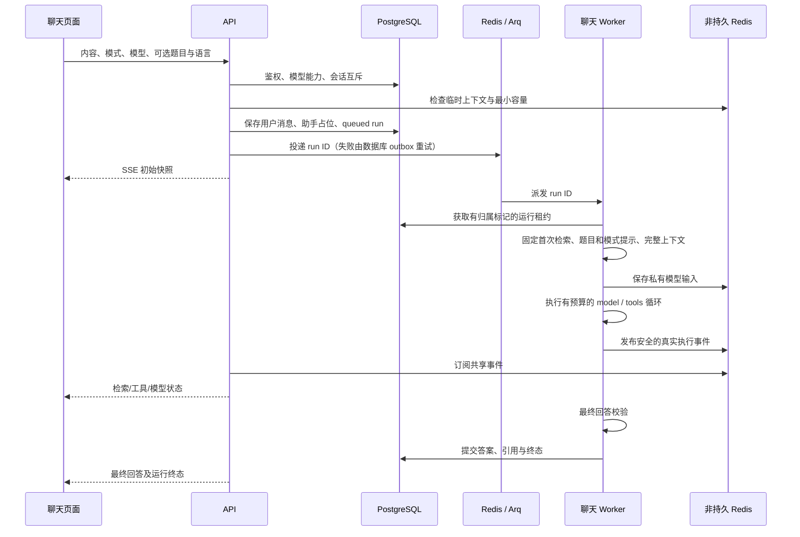
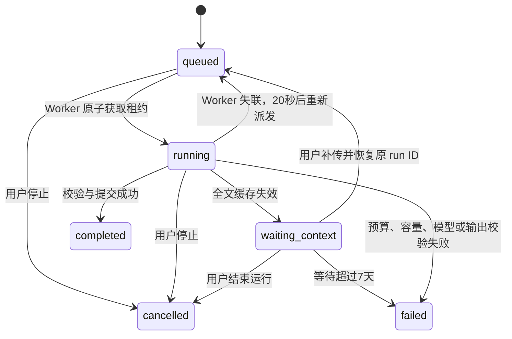

# CodeAtlas RAG 与 Agent 实现说明

日期：2026-09-29。以下描述本次代码实现与默认参数。真实用户数据库迁移、历史资料清理、提交及部署均未执行。

## 整个产品

CodeAtlas 仍是私人题库与知识库学习助教。账号提供用户隔离；题库为聊天提供用户选择的题面；长期知识库提供可引用证据；临时文件提供当前会话的完整文本上下文。普通聊天、ACM 分析和 ACM 解题共用同一个后台运行流程，只改变学习任务提示、语言要求和最终输出校验。

整体模块图可查看 [交互架构图](codeatlas-architecture.html)。图展示模块关系；以下时序图说明实际存储和调用顺序。

## 长期资料的离线 RAG

1. 用户在知识库页面上传支持格式的文件。后端验证身份、格式、大小、分组和同名冲突。
2. 原件写入 MinIO；PostgreSQL 保存文档、版本和可恢复的处理任务。202 只代表原件与任务已保存。
3. Arq Worker 加载原件，解析和清洗正文、结构与位置。DOCX 文本保留标题与表格顺序；不做 OCR。
4. 按文档结构分块，保留章节、代码行等定位信息。
5. 调用已配置的 Embedding，按独立索引 generation 写入文本块、向量和全文检索字段。
6. 全部文本块完整、非空并提交成功后，原子切换 active version/index。失败保留原先可用索引。
7. 无 Embedding 时等待配置；临时网络错误有限重试；永久错误显示失败并允许用户重试。
8. 删除或版本替换先停止旧内容参与检索，再由原有长期资料清理流程处理对象、全文及索引。必要历史引用快照继续保留。

## 聊天阶段的在线 RAG

每次新运行或需要重新建立上下文的恢复，固定执行一次长期知识检索。查询基于本次问题与对话中的查询线索，按用户、长期资料、未删除、有效版本及有效索引 generation 过滤。查询嵌入后，与 PostgreSQL 关键词召回一起通过 RRF 合并，可选 Reranker 精排，再扩展相邻文本并限制知识上下文大小。

初始检索完成后，模型获得证据 ID、正文与位置。资料不足时，模型可调用 `search_knowledge` 补查，或用 `read_knowledge_context` 读取已见证据周边。检索服务同时供固定步骤和这两个工具使用。模型最终回答中的 `[cite:UUID]` 必须引用本次实际获得的证据；未知 ID 会移除，引用快照来自实际资料。

检索无结果或失败均通过真实事件显示；失败仍允许基于题面、历史和临时全文回答，并说明依据限制。排序分值不是相关概率，也不证明回答正确。现有离线词面评测只验证召回契约；未宣称完成真实模型的端到端教学质量评测。

## 临时文件全文流程

原始上传以 raw HTTP body 接收，文件名使用编码后的 `X-File-Name` 请求头，避免 multipart 自动落盘与 URL 文件名记录。后端只在内存中解析，正文、文件名及文件 ID 放入独立非持久 Redis。不会创建知识库文档、版本、任务、文本块或向量，也不写入 MinIO。

全文用于当前会话后续消息，保留 Markdown 与源码缩进；HTML 提取文字并移除脚本/样式；DOCX 提取标题、段落与表格。UTF-8、解析容量及格式不满足要求时明确拒绝。PDF、OCR、图片内容理解及嵌入对象不在本次范围。

默认空闲24小时过期，上传后最长72小时。访问会话文件会刷新空闲期限，但不能延长绝对期限。浏览器刷新、API/Worker 重启可从仍存活的共享缓存恢复。Redis 本身丢失时无法恢复全文；正在运行的请求进入 `waiting_context`，用户补传并主动恢复同一个 run ID。没有持久化原文件元数据或指纹，所以不能承诺补传文件与原件完全一致。

临时原文、文件名、文件 ID、工具参数及模型中间输入不进入聊天数据库、任务队列、控制检查点或日志。队列只存 run ID。答案提交前检查文件名/ID、全文复制和引用比例：本次最多500字符，单文件本会话累计最多10%，禁止保存全文。用户编辑/重试输入也经过同一拦截。该检测针对可识别原文片段，不是对任意编码或语义改写泄漏的形式化证明；部署时还应控制数据库、Redis及模型服务的访问权限。

## Agent 调用循环与工具模块

使用 LangGraph 的单 Agent 图：`model → tools → model`，没有多 Agent 或 MCP。固定执行鉴权、模型准入、上下文准备、首次检索、预算控制、引用/临时内容校验和最终提交。模型只决定是否补查以及选择这两个只读工具。

确实需要工具模块函数，但不需要把所有业务都改成工具。`backend/app/agent/tools.py` 定义工具名称、JSON 参数 schema、验证、重复调用检测、执行与真实状态事件。`services/retrieval_service.py` 执行业务检索并强制用户隔离。用户 ID 来自运行上下文，不能通过工具参数改变。

| 工具 | 参数 | 返回 |
|---|---|---|
| `search_knowledge` | `query`（1–2000字符）、`limit`（1–10，默认5） | `status`、`evidence[{id,text,locator}]` |
| `read_knowledge_context` | `evidence_id`（必须已经见过）、`radius`（0–2，默认1） | 相同结果结构，周边文本重新验证所有权与有效版本 |

重复参数返回 `no_progress`，无结果返回 `no_hit`，未知工具/非法参数拒绝，未授权证据拒绝；失败/超时返回受控结果供模型下一轮处理。任何资料和工具输出都是不可信数据，不能替换系统规则。不给模型代码执行、文件写入或访问其他用户数据的能力。

默认最多2个工具轮次、4次工具执行、4次模型请求，包含重试和最终回答。每个操作至多1次瞬时错误重试；重试先预留相应预算。工具整体超时15秒，运行实际活跃时间180秒，等待补传不计入活跃时间。每次模型请求预留4096输出 tokens；最后可用请求不再提供工具。货币成本受服务商定价影响，本次通过请求数、输出上限及输入容量约束成本，没有新增计费模块。

## 发送一句聊天时

UI 显示可折叠执行步骤，不展示隐藏思维链、原始工具 JSON、参数或全文结果。回答先缓冲并通过校验再显示，防止先泄露临时原文再拦截保存；当前 SSE 实时流的是执行状态，最终正文一次返回。浏览器断线不停止后台工作；显式“停止”写入数据库并取消模型请求，不保存未校验半成品。

## 状态、失败与恢复

数据库保存运行归属、状态、计数、累计活跃时间与事件序号。唯一索引阻止同一会话的多个活跃运行，租约归属标记阻止旧 Worker 提交结果。Worker 心跳刷新租约；重启后根据数据库恢复任务。检查点仅保存布尔流程标记及计数；模型输入、工具参数、原始结果留在共享非持久缓存。缓存还在时可从图节点恢复；缺失时重新构造输入并重做首次检索，保留已花费预算。

并发停止后 Redis 原子检查停止标记，阻止旧 Worker 重新写回私有缓存。重连重放真实安全事件，前端按步骤与序号去重；旧终态事件不能终止已恢复的运行。共享事件缓存丢失时仍能从数据库得到最终答案和终态，不承诺找回已丢失的过程事件。

## 数据位置与期限

| 数据 | 位置 | 保留与清理 |
|---|---|---|
| 账号、题目、模型连接与能力结果 | PostgreSQL；模型密钥加密 | 原有用户管理策略；连接修改使能力检测失效 |
| 会话、合规用户消息及最终答案 | PostgreSQL | 删除会话时级联删除；不存模型中间输入 |
| 长期原件 | MinIO | 删除/替换后由长期清理任务处理 |
| 长期资料版本、全文、有效索引 | PostgreSQL / pgvector | 遵循长期资料版本与删除流程 |
| 必要长期引用快照 | PostgreSQL | 原件删除后仍保留；删除对应会话时删除 |
| 临时全文与文件元数据 | 独立非持久 Redis | 空闲24小时、绝对72小时；移除/删除会话清除 |
| 私有模型对话与工具中间输入 | 同一非持久 Redis 的 run context | 受临时期限约束；完成/停止清除，失败有界 TTL |
| 安全进度事件 | 非持久 Redis | 最多128条、24小时；丢失时降级为数据库终态快照 |
| 运行控制状态与控制检查点 | PostgreSQL | 终态24小时后清理；等待补传最多7天后终态清理 |
| 队列任务 | 原有 Redis / Arq | 只保存 run ID，不含临时正文或文件元数据 |

## 保留、改造和删除

- 保留账号、私人题库、知识库页面、长期上传/索引/版本/删除、会话管理和来源引用。
- 改造聊天执行、模型能力准入、共享状态恢复、临时文件处理、DOCX 文本解析、SSE 与界面反馈。
- 彻底删除聊天知识库选择控件、前端状态、请求/响应/ORM字段、检索分支、对应提示与测试/文档。
- 彻底删除聊天长期资料选择、关联前端组件、关联请求字段、专属路由与活动关联 ORM。知识库页面与引用共享逻辑继续使用。
- 删除旧内存运行器及其 Redis 租约实现，使用统一后台运行控制。
- `0016_agent_runtime` 将旧关联表改名为只读历史归档；旧会话文档、版本、全文、索引、MinIO 原件和历史引用都不删除，不自动转换或重嵌入。旧会话资料处理任务停止，不参与新检索或长期资料清理。未来处理这些历史资料需要独立确认。
- 保留历史 Alembic 迁移文件以保证升级路径，新增迁移准备字段移除和控制表。不提供旧请求字段兼容或旧关联接口。

本次没有引入 MCP、多 Agent、代码执行、联网搜索、PDF/OCR、新共享权限或新的产品模块。

## 运行前准备与验证边界

LangGraph 运行时不会自行创建检查点表，检查点 schema 由 Alembic 迁移管理。Docker/Compose 后端容器启动时先执行 `alembic upgrade head`；迁移失败则 API 不启动。已有数据升级前先备份。Windows/Linux 原生启动不会自动迁移，须先手动执行 `alembic upgrade head`。需要独立的 `EPHEMERAL_REDIS_URL`；不能使用队列 Redis 的另一个逻辑 DB，且启动会验证 `appendonly=no` 与 `save=''`。Compose 配置无临时数据卷、内存上限256MB、`noeviction`。外部部署的日志代理也应排除临时文件 URL 与请求头/正文。

模型连接检测只发送一次普通聊天请求，验证当前连接与模型组合；网络或限流失败记为检测未完成。无需填写上下文容量；已知容量继续用于提前拦截超限，未知容量交由服务商判断。新检测的模型只走普通聊天，旧模型已验证的原生工具能力仍可用于补查，不采用文字模拟工具或自动切换模型。

Windows 原生 Worker 使用 `uv run python -m app.worker_runner`；API 使用 `uv run python -m app.api_runner`，均使用 SelectorEventLoop。Docker/Linux 使用原有 Uvicorn/Arq 入口。LangGraph 与 PostgreSQL saver 固定版本，调整版本需连同检查点 schema 评审。

集成测试只允许 `codeatlas_agent_test` 数据库，使用 `infra/compose.agent-test.yml` 的独立端口与临时内存数据。模型 HTTP 边界使用测试响应，因此测试证明执行协议、隔离与恢复，不能代替真实模型服务商或回答质量验收。
